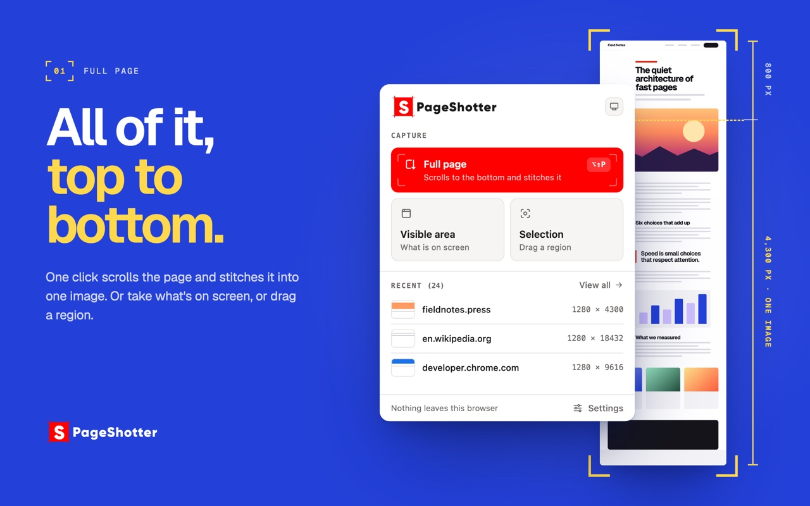
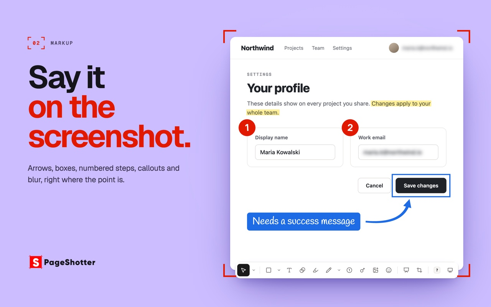
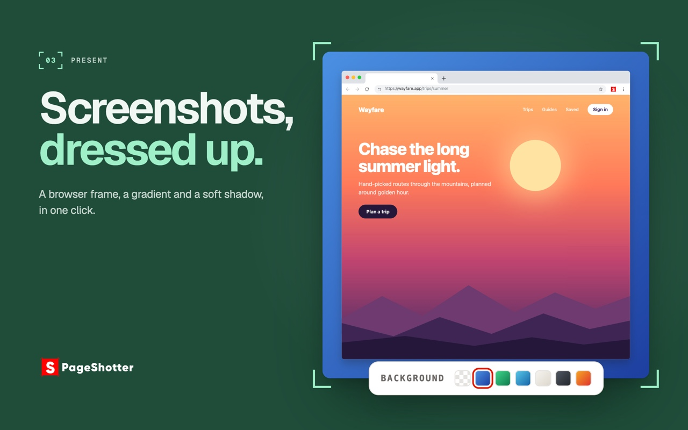
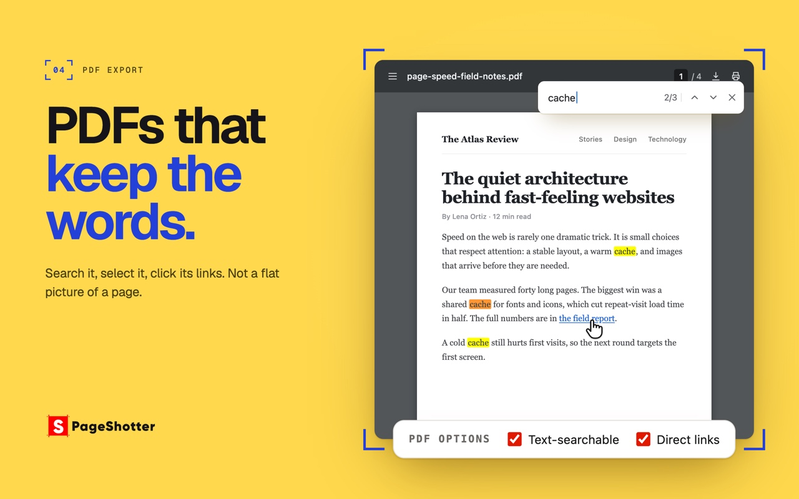
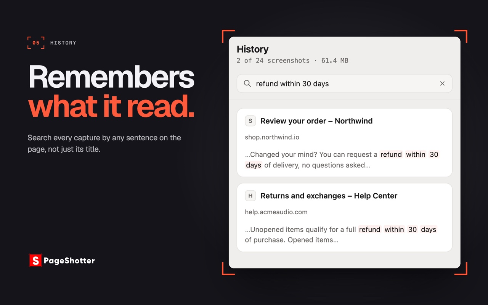

<p align="center">
  <a href="https://www.pageshotter.com">
    <picture>
      <source media="(prefers-color-scheme: dark)" srcset=".github/assets/logo-dark.svg" />
      
    </picture>
  </a>
</p>

<p align="center">
  Full-page, visible-area and selection screenshots for Chrome, captured and edited entirely on your
  own computer. Export PNG, JPEG, WebP, or a PDF with searchable text and clickable links.
</p>

<p align="center">
  <a href="https://chromewebstore.google.com/detail/ndinpmhlpgieahdpmkibnngijihalclf"></a>
  <a href="https://github.com/pushpendersingh1/pageshotter/actions/workflows/verify.yml"></a>
  <a href="LICENSE"></a>
</p>

<p align="center">
  <a href="https://chromewebstore.google.com/detail/ndinpmhlpgieahdpmkibnngijihalclf"><strong>Install from the Chrome Web Store</strong></a> ·
  <a href="https://www.pageshotter.com">Website</a> ·
  <a href="https://www.pageshotter.com/privacy/">Privacy policy</a>
</p>

<p align="center">
  
</p>

## What it does

- **Full page.** Scrolls to the bottom and stitches every screenful into one image. Sticky headers
  appear once, where they belong, instead of being stamped into every section. Lazy-loaded images,
  infinite feeds and pages that scroll inside a container are handled generically, never with
  per-site rules.
- **Visible area.** One frame of exactly what is on screen; the page is not touched.
- **Selection.** Drag a region, or hold Ctrl to pick a whole element.
- **Editor.** Rectangles, ellipses, arrows, lines, text, highlights, numbered badges, a magnifier,
  emoji and blur, with layers, groups, crop and undo. The original capture is never overwritten.
- **Present.** Wrap a capture in a mock browser window with a background, margin, corners, shadow
  and date stamp.
- **History.** Reopen and re-export earlier captures, and search them by the words on the page.
- **Batch capture.** Paste a list of addresses; each page is opened, captured and saved as its own
  file, with a report of anything that failed and a Retry for it.

<table>
  <tr>
    <td></td>
    <td></td>
  </tr>
  <tr>
    <td></td>
    <td></td>
  </tr>
</table>

## Privacy

PageShotter makes no network requests. There is no server, account, analytics or remote code, and
its only required permissions are `activeTab`, `scripting` and `contextMenus` (the right-click menu). `downloads` is optional and requested
only if you choose to save into a folder. Access to all websites is optional too, and requested only
when you start a batch capture: the browser lets an extension screenshot a tab you didn't open it on
only with that access. Everything it keeps is in the extension's own browser
storage; [`public/welcome.html`](public/welcome.html) lists exactly what is stored and for how long.

## Build and load it yourself

Requires Node.js 22+ and Chrome or Edge 120+.

```bash
npm ci
npm run verify        # lint + typecheck + tests + build every browser
npm run dev           # rebuild dist/ on every change
npm run package       # build + zip for the Chrome Web Store
npm run build:edge    # build dist-edge/ for Microsoft Edge
npm run package:edge  # build + zip for Edge Add-ons
npm run build:firefox # build dist-firefox/ for Firefox
npm run package:firefox # build + zip for Firefox Add-ons, plus the source zip AMO requires
```

Then open `chrome://extensions` (or `edge://extensions`), turn on **Developer mode**, choose
**Load unpacked** and select `dist/` (or `dist-edge/`). In Firefox 153 or later, open
`about:debugging#/runtime/this-firefox`, choose **Load Temporary Add-on** and pick
`dist-firefox/manifest.json`. Chrome must keep the source tab active during a full-page capture, because
`tabs.captureVisibleTab()` only captures the active tab.

`npm run fixtures` serves the difficult-page test corpus at `http://localhost:4173`: sticky headers,
lazy images, nested scrollers, infinite feeds and more. Automated tests cover geometry and planning
only, so a change to captured output is checked by capturing those pages by hand.

## Architecture

```
src/
  background/   capture orchestration, cancellation, rate limiting, recovery
  content/      page analysis, scrolling, reversible page mutations, lazy-content settling
  result/       stitching, preview, export (PNG/JPEG/WebP and a hand-written PDF writer)
  editor/       the annotation editor: a pure scene model and two renderers
  popup/        the toolbar popup
  history/      saved captures
  batch/        batch capture of a list of addresses
  settings/     preferences
  welcome/      the first-run page
  shared/       messages, geometry, limits, IndexedDB, errors
public/         extension pages, styles, icons and the manifest
tests/          Vitest unit tests (plain Node, no DOM) and the fixture corpus
```

[`AGENTS.md`](AGENTS.md) holds the engineering conventions and the invariants every change must keep.

## Contributing

The most useful report is a public page that captures wrong: [open an issue](../../issues) with
its address, what you expected and what you got. Questions and ideas go in
[Discussions](../../discussions). For a pull request, keep it to
one change, run `npm run verify`, and read [`AGENTS.md`](AGENTS.md) first: a change that adds a
permission, sends anything off the device or special-cases a website will not be merged. If a change
affects what a capture looks like, say which fixtures you checked by hand.

To report a security problem, see [`SECURITY.md`](SECURITY.md); please do not open a public issue.

## License

The code is [MIT](LICENSE). The PageShotter name and logo are not covered by that license; see
[`TRADEMARKS.md`](TRADEMARKS.md). Bundled third-party components and their licenses are listed in
[`public/THIRD_PARTY_NOTICES.txt`](public/THIRD_PARTY_NOTICES.txt).
